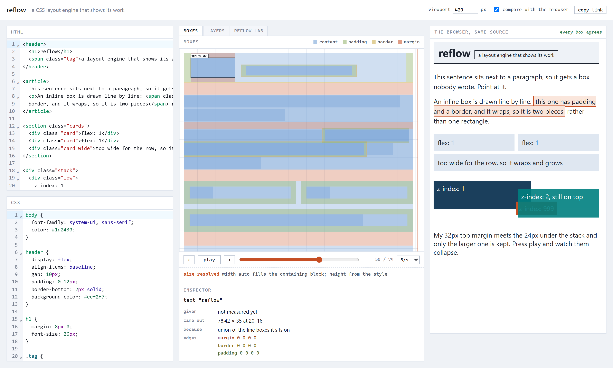
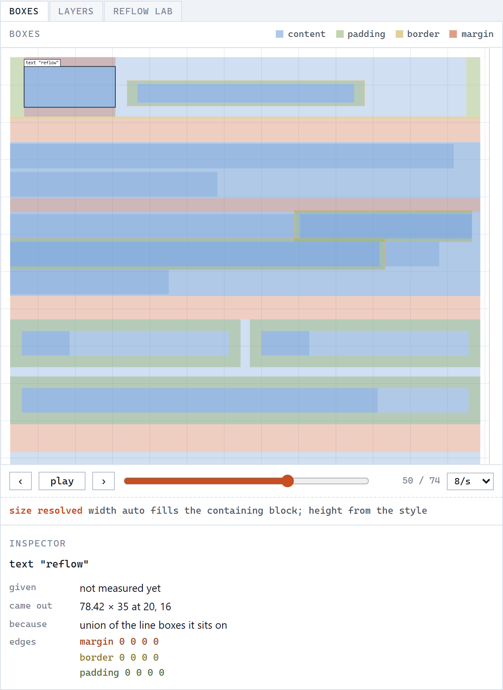
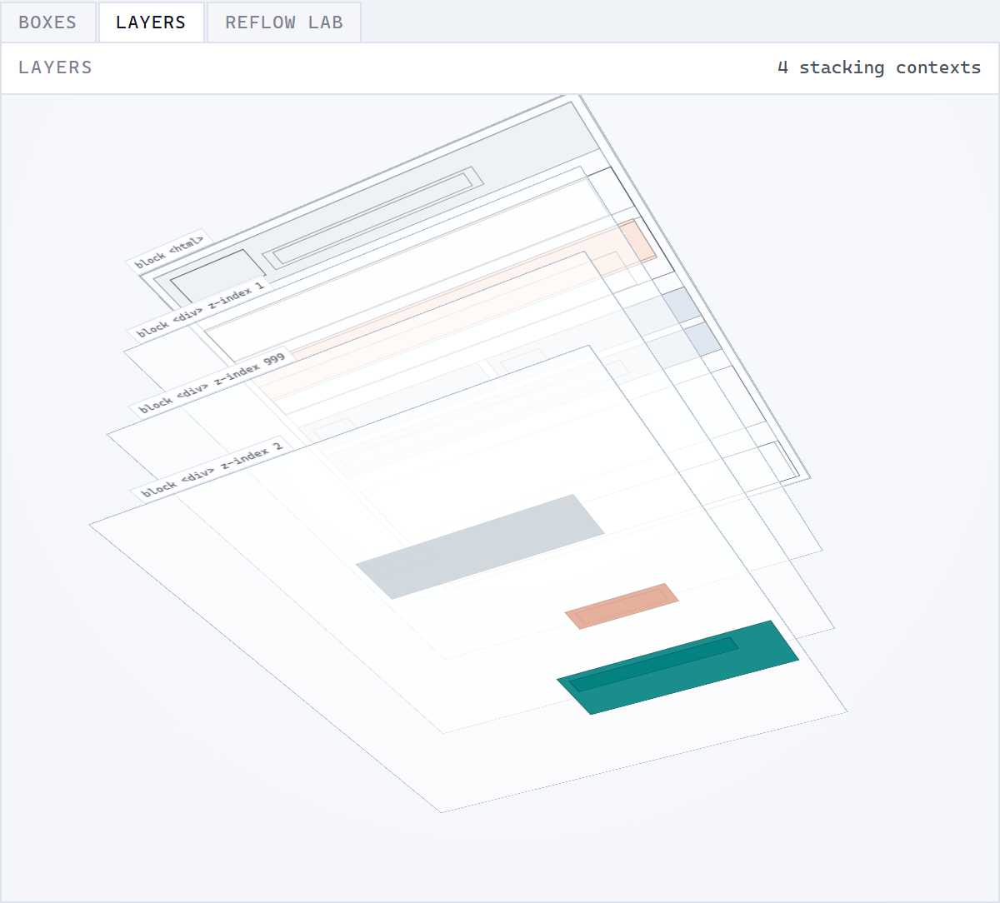
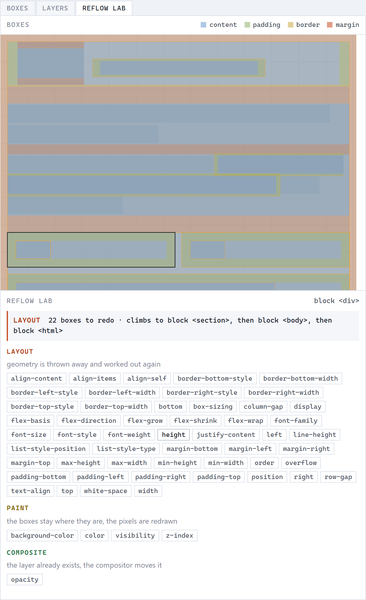

# reflow

A CSS layout engine in TypeScript, and a visualizer that replays what the engine did.



Layout debuggers show you the result. This one records the pass itself: the engine emits an
event every time it measures a box, resolves a size, collapses margins or breaks a line, and the
app is a player over that list. Next to it the browser renders the same source, and every box is
compared with the engine's.

## The three views



**Boxes.** Every box as content, padding, border and margin, including the anonymous ones
DevTools never shows. Press play or drag the slider to watch the layout happen, and point at a
box to see what it was given and why it came out that size.



**Layers.** Stacking contexts on 3D planes, in the order they paint. This is the view that
explains why a `z-index: 999` can still end up behind a `z-index: 2`.



**Reflow lab.** Pick a box and a property to see whether a change costs layout, paint or just a
composite, and how far up the tree it reaches.

## Running it

```
pnpm install
pnpm -F @reflow/app dev
```

`pnpm test` runs the unit tests and the Chromium comparison. The comparison needs a browser
once: `pnpm -F @reflow/conformance exec playwright install chromium`.

## Deploying it

Every push to `main` that passes CI is published to GitHub Pages at
[nikolaimelni.github.io/reflow](https://nikolaimelni.github.io/reflow/). Pages sends no headers
of its own, so the build puts a content security policy in the page instead, which matters
here because a shared link carries someone else's HTML.

## What it supports

Block and inline layout with margin collapsing and line breaking, `inline-block`, relative and
absolute positioning, flexbox with wrapping, list markers, and paint order with `z-index` and
`opacity`. Floats, grid, tables, `calc()` and writing modes are left out.

## How it is checked

Forty four fixtures run in real Chromium against the engine: computed styles, every border box
to within half a pixel, and what `elementFromPoint` finds, 104220 comparisons, all matching. A
generator built on fast-check also writes random documents and shrinks any that disagree to a
few lines.

## License

MIT, see [LICENSE](LICENSE).
